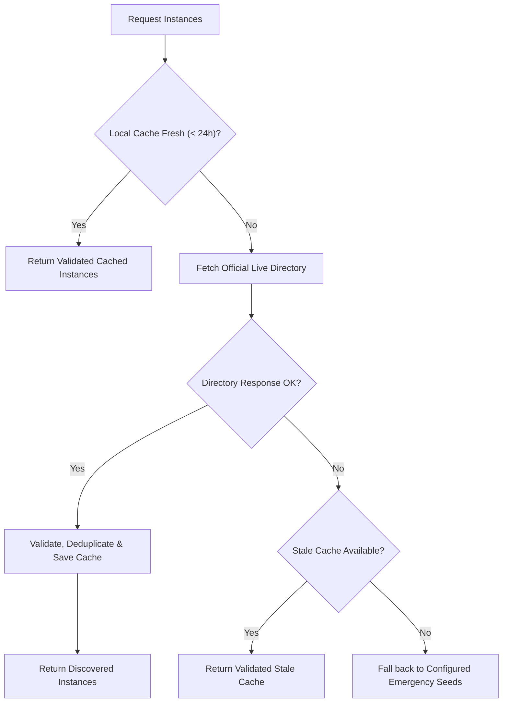

# Public Instance Directories & Health Architecture

This document specifies the official directory endpoints, schemas, validation rules, health checks, and caching strategies implemented in **TimePlayer**.

---

## 1. Piped API Directory

### Official Maintained Source
- **Documentation**: https://github.com/TeamPiped/documentation/blob/main/content/docs/public-instances/index.md
- **Raw Machine-Readable Source**: `https://raw.githubusercontent.com/TeamPiped/documentation/main/content/docs/public-instances/index.md`

### Format Specification & Parsing Assumptions
- **Format**: GitHub-Flavored Markdown table with frontmatter.
- **Headers**:
  ```markdown
  Instance Name | Instance API URL | Instance Location(s) | CDN | Registered Users
  --- | --- | --- | --- | ---
  kavin.rocks (Official) | https://pipedapi.kavin.rocks | 🇺🇸, 🇮🇳 | Cloudflare | Yes
  ```
- **Parsing Rules**:
  1. Frontmatter (`---`) and table header/separator rows are stripped.
  2. Each row is delimited by `|`.
  3. Columns are scanned for HTTPS URLs matching `https://[^\s|]+`.
  4. The URL is extracted, sanitized, and normalized (e.g. `https://pipedapi.kavin.rocks/`).
  5. Insecure (`http://`) or malformed entries are rejected immediately.
  6. Duplicate entries are deduplicated by base URI.

### Lightweight Health Check
- **Endpoint**: `GET /trending?region=US` (or `/trending`)
- **Validation**:
  - Requires HTTP 200 OK.
  - Requires JSON response with root `ValueKind == JsonValueKind.Array`.
  - Measures request-to-response latency.
  - Timeout: 5 seconds.

---

## 2. Invidious API Directory

### Official Maintained Source
- **API Endpoint**: `https://api.invidious.io/instances.json?sort_by=health`
- **Documentation**: https://docs.invidious.io/api/

### Format Specification & Parsing Assumptions
- **Format**: JSON array of tuples:
  ```json
  [
    [
      "invidious.f5.si",
      {
        "flag": "🇯🇵",
        "region": "JP",
        "stats": {
          "version": "2.0",
          "software": { "name": "invidious", "version": "2026.10.11-7286c6d" }
        },
        "cors": true,
        "api": true,
        "type": "https",
        "uri": "https://invidious.f5.si",
        "monitor": {
          "uptime": 98.2,
          "down": false
        }
      }
    ]
  ]
  ```
- **Parsing Rules**:
  1. Root element is an array of 2-element arrays (`[ [ "domain", { ... } ] ]`).
  2. Element 1 is inspected for:
     - `"api": true` (instances with API disabled are filtered out).
     - `"type": "https"` (insecure HTTP instances are filtered out).
     - `"monitor.down": false` (down instances are skipped).
  3. Base URI is sanitized via `InstanceUrlValidator`.
  4. Health score is derived from `"monitor.uptime"` (0.0 to 100.0).
  5. Software version is extracted from `"stats.software.version"`.

### Lightweight Health Check
- **Endpoint**: `GET /api/v1/stats`
- **Validation**:
  - Requires HTTP 200 OK.
  - Requires JSON response with root `ValueKind == JsonValueKind.Object`.
  - Requires presence of `"software"` or `"version"` properties.
  - Measures latency.
  - Timeout: 5 seconds.

---

## 3. Security, Privacy & Validation Rules

- **Strict HTTPS**: Only `https://` URLs are permitted. `http://`, `ftp://`, `file://`, and relative URLs are rejected.
- **No Credentials**: Any URL containing `user:pass@` is rejected.
- **No Loopback / Localhost**: `localhost`, `127.0.0.1`, and loopback IPs are blocked in production.
- **Privacy Headers**:
  - `SocketsHttpHandler.UseCookies = false` (no cookies are stored, sent, or accepted).
  - No authorization headers or Google credentials are sent.
  - `AllowAutoRedirect = false` (prevents malicious or insecure HTTP redirects).

---

## 4. Local Persistence & Fallback Hierarchy



- **Cache Location**:
  `%LOCALAPPDATA%\TimePlayer\cache\instances_{provider}.json`
- **Integrity Guarantee**: Every record loaded from the local cache file is re-validated through `InstanceUrlValidator` to prevent tampering or corrupted entries from bypassing security.
- **Rate Limit Handling (HTTP 429)**: Triggers an extended 15-minute cooldown.
- **Connection Failure Handling**: Exponential backoff cooldown (`2 * (consecutiveFailures + 1)` minutes).
